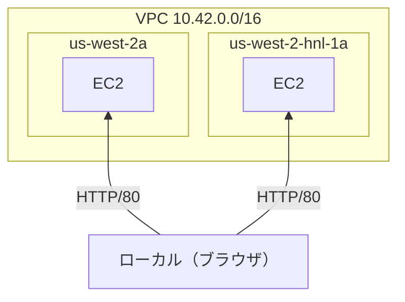
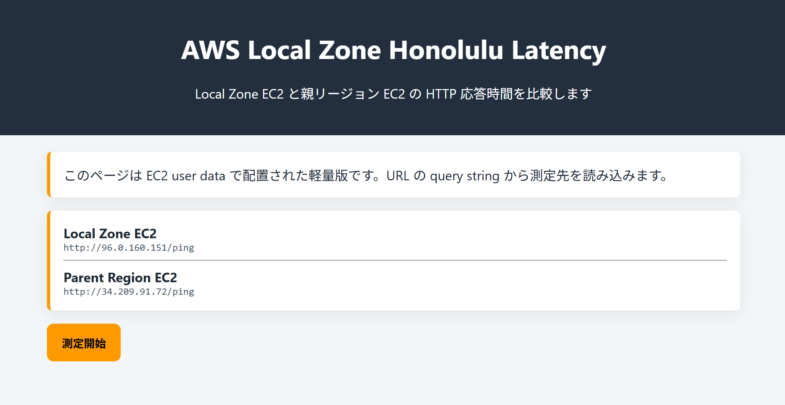
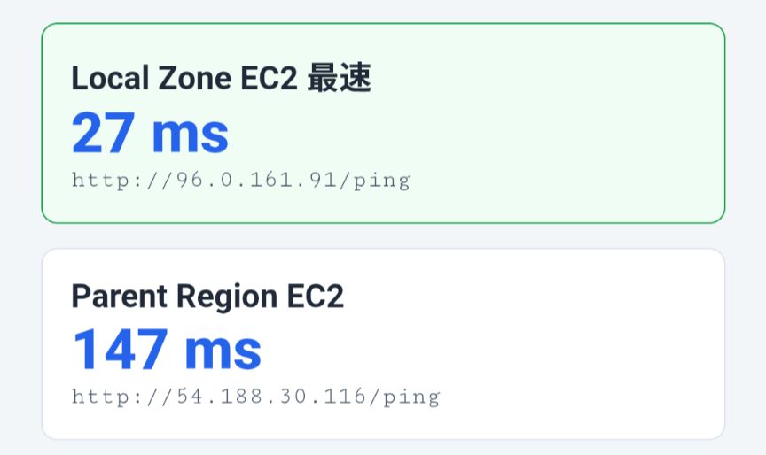

このリポジトリは AWS Deep Cuts の、AWS Local Zones に関するハンズオンコンテンツです。

AWS Local Zonesの解説記事(Qiita)は[こちら](https://qiita.com/kenken38/items/d27e5d543d051bcffc8f)

> ⚠️ **コストに関する注意**
>
> このハンズオンで作成するリソース（EC2 × 2台 + パブリック IPv4）は、稼働中 **約 $0.10/時間** のコストが発生します。
>
> | 放置期間 | 概算コスト |
> | --- | --- |
> | 1日 | 約 **$2.5**（約 400円） |
> | 1週間 | 約 **$17**（約 2,600円） |
>
> **検証が終わったら速やかに後片付けを実施してください。**

# AWS Deep Cutsとは
AWS Deep Cutsは、AWS の最新のサービスやニッチな機能、または高度にアカデミックな知識を要求するサービスなど、多くの人が知らない 『隠れた名曲 = **Deep Cuts**』 を深くまで掘り下げる技術シリーズです。

このようなサービスはWeb情報も少なく、初学者は気軽にキャッチアップできないのが実情です。

そこで AWS Deep Cuts シリーズでは、**前提知識も含めた分かりやすいサービス解説** と **手順通りに進めれば誰でも再現できるハンズオン** を提供します！

# ハンズオンのゴール

このハンズオンでは、ハワイ（ホノルル）の Local Zoneである `us-west-2-hnl-1a` とその親リージョンである `us-west-2` にそれぞれ EC2 を作成し、ブラウザからの HTTP 応答時間を比較します。

ハワイから測定した場合、ホノルル Local Zone の EC2 への応答が親リージョン（オレゴン）の EC2 よりも速いことを確認します。

# ハンズオン手順

以降の手順は、ハンズオン用に用意した AWS アカウントで実施してください。

## 構築するアーキテクチャ



以降、各種コマンドは[CloudShell](https://docs.aws.amazon.com/cloudshell/latest/userguide/welcome.html)で実行してください。

## １．事前準備

VPC、サブネット、Internet Gateway、Security Group など、Local Zone と直接関係のないネットワーク基盤をセットアップします。

```bash
# このリポジトリをクローン
git clone https://github.com/AWS-Deep-Cuts/aws-local-zones
cd aws-local-zones/hands-on

# セットアップスクリプトの実行
bash ./setup.sh

# 以下の文言が表示されればセットアップ成功です
# ✅ セットアップが完了しました！
```

setup.sh は以下のリソースを作成します：
- VPC（`10.42.0.0/16`）
- Internet Gateway
- パブリックルートテーブル
- Local Zone 用サブネット（`us-west-2-hnl-1a`）
- 親リージョン用サブネット（`us-west-2a`）
- Security Group（HTTP 80番ポートを許可）

## ２．EC2 の作成

### Local Zone のオプトイン確認

Local Zone はデフォルトでは無効になっています。利用するにはオプトイン（有効化）が必要です。

setup.sh で自動的にオプトインしていますので、以下のコマンドでオプトイン状態を確認してください。

```bash
aws ec2 describe-availability-zones \
  --all-availability-zones \
  --filters "Name=group-name,Values=us-west-2-hnl-1" \
  --region us-west-2 \
  --query 'AvailabilityZones[].{ZoneName:ZoneName,State:State,OptInStatus:OptInStatus}'
```

`OptInStatus` が `opted-in` であれば正常にオプトイン(有効化)されています。

### EC2 の起動

マネジメントコンソールから Local Zone と親リージョンにそれぞれ EC2 を起動します。以下の手順を **2回** 実施してください（1回目: Local Zone 用、2回目: 親リージョン用）。

1. [EC2 コンソール](https://us-west-2.console.aws.amazon.com/ec2/home?region=us-west-2#LaunchInstances:)を開き、**インスタンスを起動** をクリック

2. **名前とタグ**
   - 1回目: `aws-deepcuts-lz-local`
   - 2回目: `aws-deepcuts-lz-regional`

3. **AMI**
   - `Amazon Linux 2023 AMI` を選択（デフォルトで選択済み）

4. **インスタンスタイプ**
   - `t3.medium` を選択

5. **キーペア**
   - 「キーペアなしで続行」を選択（SSH 接続は不要）

6. **ネットワーク設定** → 「編集」をクリック
   - **VPC**: setup.sh で作成した VPC（`10.42.0.0/16`）を選択
   - **サブネット**:
     - 1回目: `us-west-2-hnl-1a` のサブネットを選択（Local Zone）
     - 2回目: `us-west-2a` のサブネットを選択（親リージョン）
   - **パブリック IP の自動割り当て**: 有効化
   - **ファイアウォール（セキュリティグループ）**: 「既存のセキュリティグループを選択する」→ setup.sh で作成した SG を選択

7. **ストレージ**
   - `8 GiB`、`gp2`

8. **高度な詳細** を展開し、一番下の **ユーザーデータ** 欄に以下を貼り付け

```bash
#!/bin/bash
set -eux

mkdir -p /opt/aws-deepcuts-local-zone

cat > /opt/aws-deepcuts-local-zone/ping <<'PING'
ok
PING

cat > /opt/aws-deepcuts-local-zone/index.html <<'HTML'
<!DOCTYPE html>
<html lang="ja">
<head>
  <meta charset="UTF-8">
  <meta name="viewport" content="width=device-width, initial-scale=1.0">
  <title>AWS Local Zone Honolulu Latency</title>
  <style>
    body { font-family: -apple-system, BlinkMacSystemFont, 'Segoe UI', Arial, sans-serif; margin: 0; background: #f3f6f8; color: #1f2937; }
    header { background: #232f3e; color: #fff; padding: 24px 18px; text-align: center; }
    main { max-width: 840px; margin: 0 auto; padding: 20px; }
    .box { background: #fff; border-left: 4px solid #ff9900; border-radius: 6px; padding: 16px; margin-bottom: 16px; box-shadow: 0 4px 16px rgba(15,23,42,.08); }
    button { background: #ff9900; border: 0; border-radius: 8px; padding: 13px 18px; font-weight: 700; cursor: pointer; }
    .result { border: 1px solid #dbe4ee; border-radius: 8px; padding: 14px; margin: 12px 0; background: #fff; }
    .fastest { border-color: #16a34a; background: #f0fdf4; }
    .latency { font-size: 28px; font-weight: 800; color: #2563eb; }
    .url { font-family: Consolas, 'Courier New', monospace; font-size: 12px; overflow-wrap: anywhere; color: #475569; }
  </style>
</head>
<body>
  <header>
    <h1>AWS Local Zone Honolulu Latency</h1>
    <p>Local Zone EC2 と親リージョン EC2 の HTTP 応答時間を比較します</p>
  </header>
  <main>
    <div class="box">このページは EC2 user data で配置された軽量版です。URL の query string から測定先を読み込みます。</div>
    <div class="box" id="targets"></div>
    <button id="startBtn">測定開始</button>
    <div id="results"></div>
    <div class="box" id="summary" style="display:none"></div>
  </main>
  <script>
    const params = new URLSearchParams(location.search);
    const endpoints = [
      { key: 'local', name: 'Local Zone EC2', url: params.get('local') },
      { key: 'regional', name: 'Parent Region EC2', url: params.get('regional') }
    ].filter(item => item.url);
    const targets = document.getElementById('targets');
    targets.innerHTML = endpoints.map(item => `<strong>${item.name}</strong><div class="url">${item.url}</div>`).join('<hr>');
    function cacheBust(url) { return url + (url.includes('?') ? '&' : '?') + 't=' + Date.now() + '-' + Math.random().toString(36).slice(2); }
    async function measure(endpoint) {
      const values = [];
      for (let index = 0; index < 5; index++) {
        const started = performance.now();
        await fetch(cacheBust(endpoint.url), { method: 'HEAD', mode: 'no-cors', cache: 'no-store' });
        values.push(performance.now() - started);
        await new Promise(resolve => setTimeout(resolve, 120));
      }
      values.sort((a, b) => a - b);
      return { ...endpoint, latency: values[2] };
    }
    function render(result, fastestKey) {
      return `<div class="result ${result.key === fastestKey ? 'fastest' : ''}"><strong>${result.name}${result.key === fastestKey ? ' 最速' : ''}</strong><div class="latency">${Math.round(result.latency)} ms</div><div class="url">${result.url}</div></div>`;
    }
    document.getElementById('startBtn').onclick = async () => {
      const button = document.getElementById('startBtn');
      const resultsDiv = document.getElementById('results');
      const summary = document.getElementById('summary');
      button.disabled = true;
      button.textContent = '測定中...';
      resultsDiv.textContent = '測定しています...';
      const results = [];
      for (const endpoint of endpoints) results.push(await measure(endpoint));
      const fastest = results.reduce((best, item) => item.latency < best.latency ? item : best, results[0]);
      resultsDiv.innerHTML = results.map(item => render(item, fastest.key)).join('');
      const local = results.find(item => item.key === 'local');
      const regional = results.find(item => item.key === 'regional');
      if (local && regional) {
        const diff = local.latency - regional.latency;
        summary.textContent = diff < 0 ? `Local Zone EC2 が親リージョン EC2 より約 ${Math.round(Math.abs(diff))} ms 速い結果です。` : `Local Zone EC2 が親リージョン EC2 より約 ${Math.round(diff)} ms 遅い結果です。`;
        summary.style.display = 'block';
      }
      button.disabled = false;
      button.textContent = '再測定';
    };
  </script>
</body>
</html>
HTML

cat > /etc/systemd/system/aws-deepcuts-web.service <<'SERVICE'
[Unit]
Description=AWS Deep Cuts local latency web server
After=network-online.target
Wants=network-online.target

[Service]
Type=simple
ExecStart=/usr/bin/python3 -m http.server 80 --directory /opt/aws-deepcuts-local-zone
Restart=always
RestartSec=3

[Install]
WantedBy=multi-user.target
SERVICE

systemctl daemon-reload
systemctl enable --now aws-deepcuts-web.service
```

9. **インスタンスを起動** をクリック

#### パブリック IP の確認

2台とも起動したら、EC2 コンソールのインスタンス一覧からそれぞれの **パブリック IPv4 アドレス** を控えてください。

- `aws-deepcuts-lz-local` の IP → 以降 `<LOCAL_IP>` と表記
- `aws-deepcuts-lz-regional` の IP → 以降 `<REGIONAL_IP>` と表記

EC2 の user data が完了するまで 1〜2 分かかります。

以下のコマンドを実行します。
```
curl http://<LOCAL_IP>/ping
curl http://<REGIONAL_IP>/ping

# ok と表示されれば EC2 の作成は完了です。
```

### 測定ページへのアクセス

Local Zone の EC2 上に測定ページがデプロイされます。以下の URL をブラウザで開いてください。

```
http://<LOCAL_IP>/?local=http://<LOCAL_IP>/ping&regional=http://<REGIONAL_IP>/ping
```



## ３．結果の確認

### 期待される結果

| 通信元 → 通信先 | 実際の経路 | レイテンシ |
| --- | --- | --- |
| ホノルル → Local Zone EC2 | ホノルル市内のみ | 1桁ミリ秒 程度 |
| ホノルル → us-west-2 EC2 | ホノルル → オレゴン | Local Zone より**遅い** |

詳細はサービス解説記事の[本ハンズオンでのレイテンシ測定について](https://qiita.com/kenken38/items/d27e5d543d051bcffc8f#%E6%9C%AC%E3%83%8F%E3%83%B3%E3%82%BA%E3%82%AA%E3%83%B3%E3%81%A7%E3%81%AE%E3%83%AC%E3%82%A4%E3%83%86%E3%83%B3%E3%82%B7%E6%B8%AC%E5%AE%9A%E3%81%AB%E3%81%A4%E3%81%84%E3%81%A6)を参照してください。

### 測定結果例



## ４．後片付け

検証が終わったら、無駄な課金を防ぐためにリソースを削除しましょう。

CloudShellで以下のコマンドを実行することで、今回作成したリソースを綺麗に削除することができます！

```bash
cd aws-local-zones/hands-on
bash ./cleanup.sh

# 以下の文言が表示されればクリーンアップ成功です
# ✅ すべてのリソースの削除が完了しました！

cd ../..
sudo rm -rf aws-local-zones
```
