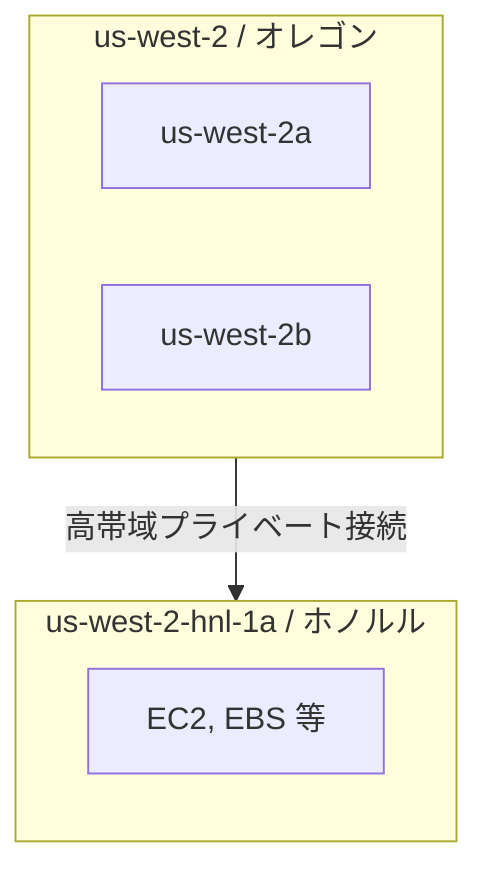
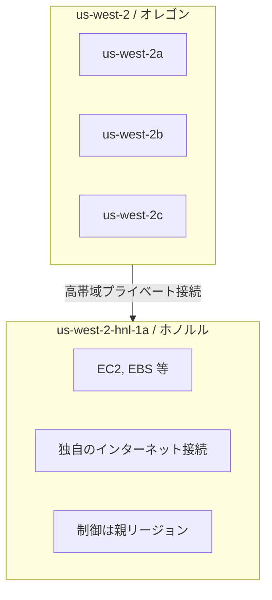
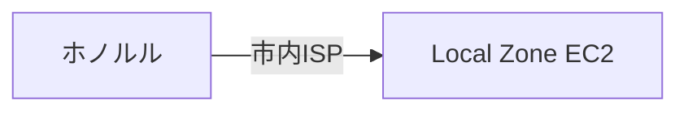
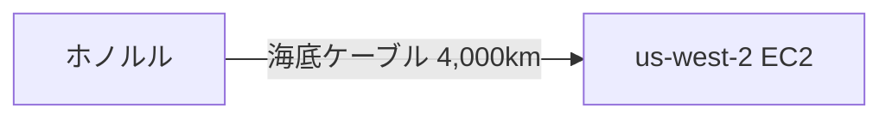
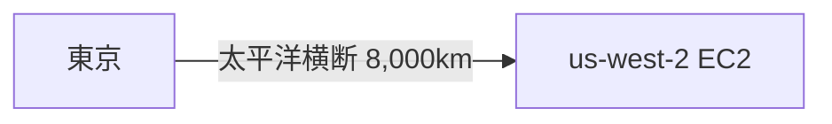
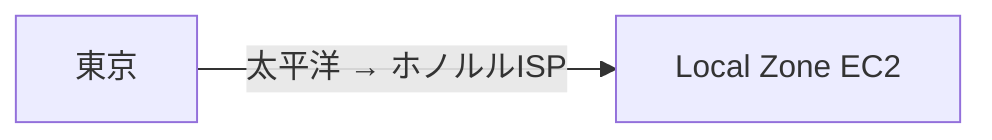

:::note info
AWS Deep Cuts の GitHub はこちらです。
https://github.com/AWS-Deep-Cuts/AWS-Deep-Cuts
:::

# AWS Deep Cutsとは？
AWS Deep Cutsは、AWS の最新のサービスやニッチな機能、または高度にアカデミックな知識を要求するサービスなど、多くの人が知らない 『隠れた名曲 = **Deep Cuts**』 を深くまで掘り下げる技術シリーズです。

このようなサービスはWeb情報も少なく、初学者は気軽にキャッチアップできないのが実情です。

そこで AWS Deep Cuts シリーズでは、**前提知識も含めた分かりやすいサービス解説** と **手順通りに進めれば誰でも再現できるハンズオン** を提供します！

# AWS Local Zonesとは？

**AWS Local Zones** は、親リージョンの拡張として特定の都市圏に配置されるインフラです。コンピュート・ストレージ・データベースなど一部の AWS サービスを、エンドユーザーや産業拠点の近くに配置し、低レイテンシーなアクセスを実現します。

:::note info
イメージしやすい例で説明すると、「東京リージョンは日本にあるけど、大阪にもう少しだけ AWS を出張させたい」というのが Local Zones の発想です。実際に東京リージョンの Local Zone として大阪ローカルゾーンが存在します（※2024年にフルリージョン昇格済み）。

Local Zones は **リージョンそのもの** ではなく、あくまで **親リージョンの出先機関** です。利用できるサービスは限定的ですが、物理的にユーザーの近くにワークロードを置けるため、数ミリ秒単位のレイテンシー削減が可能になります。
:::

AWS Local Zones は、親リージョンの拡張として特定の都市圏に配置されるインフラです。コンピュート、ストレージなど一部の AWS サービスをエンドユーザーの近くに配置し、低レイテンシーなアクセスを実現します。親リージョンへの高帯域プライベート接続を持つため、Local Zone に配置していないサービスには親リージョン経由でアクセスできます。

Local Zone はリージョンではありません。あくまで親リージョンの「拡張」であり、利用できるサービスは限定的です。一方で、物理的にエンドユーザーの近くにワークロードを配置できるため、レイテンシーの削減が可能です。

日本には AWS Local Zones が存在しないため、なかなか実体験する機会がありません。AWS re:Invent などで海外に行く際にはぜひ試してみてください！

# AWS Local Zonesの特徴

- **親リージョンの拡張**
  Local Zone は独立したリージョンではなく、親リージョンの VPC をサブネットとして拡張する形で利用します。既存の API・ツール・セキュリティモデルをそのまま使えます。

- **ローカルなインターネット接続**
  Local Zone は独自のインターネットゲートウェイを持ち、**インターネットトラフィックは親リージョンを経由せず、Local Zone から直接出入りします**。これにより、Local Zone 近くのユーザーは低レイテンシーで通信できます。

- **オプトイン方式**
  Local Zone はデフォルトでは無効です。利用するには明示的にオプトイン（有効化）する必要があります。

- **利用可能サービスの制限**
  EC2、EBS、ELB、ECS、EKS など一部のサービスのみ利用可能です。S3 や DynamoDB のようなリージョナルサービスは Local Zone には配置されず、親リージョンのエンドポイントを使います。

- **世界各地に展開**
  北米・南米・ヨーロッパ・アジア太平洋・中東・アフリカの都市に展開されています。

# Local Zones と Region の関係

重要なポイント：
- **データプレーン**（実際のトラフィック処理）は Local Zone 内で行われる
- **コントロールプレーン**（API呼び出し、リソース管理）は親リージョンで動作する
- Local Zone のインターネットトラフィックは **親リージョンを経由しない**（AWS公式ドキュメント記載）

# ホノルル Local Zone と us-west-2 への通信経路とレイテンシ

今回のハンズオンでは、ホノルル Local Zone（`us-west-2-hnl-1a`）とその親リージョン us-west-2（オレゴン）を使ってレイテンシを比較します。

## 通信経路の整理

### ホノルル → ホノルル Local Zone EC2

- Local Zone はホノルル市内に物理的に存在する
- Local Zone は独自のインターネット接続を持つため、親リージョンを経由しない
- 通信はホノルル市内で完結 → **最速**

### ホノルル → us-west-2 EC2（オレゴン）

- ホノルルとオレゴンは太平洋の海底ケーブルで接続
- 物理的な距離に起因するレイテンシが発生 → Local Zone より**遅い**

### 東京 → us-west-2 EC2（オレゴン）

- 太平洋横断のレイテンシ（概ね 80〜100ms 程度）が支配的

### 東京 → ホノルル Local Zone EC2

- Local Zone は独自のインターネット接続を持つため、東京からのトラフィックはインターネット経路を通じて直接ホノルルの Local Zone に到達する
- ただし東京からホノルルまでの物理的距離（約6,200km）分のレイテンシは発生する
- インターネットの経路選択（ISPルーティング）次第で、オレゴン経由になる場合もある

:::note warn
Local Zone は親リージョンを経由せずに直接インターネットからのトラフィックを受け付けます（[AWS公式ドキュメント](https://docs.aws.amazon.com/local-zones/latest/ug/local-zones-connectivity-igw.html)）。ただし、実際のインターネット経路は ISP のルーティングに依存するため、必ずしも地理的最短経路を通るとは限りません。
:::

## レイテンシまとめ

| 通信元 → 通信先 | 経路 | レイテンシ傾向 |
| --- | --- | --- |
| ホノルル → Local Zone EC2 | ホノルル市内で完結 | **最速** |
| ホノルル → us-west-2 EC2 | 海底ケーブルでオレゴンへ | Local Zone より**遅い** |
| 東京 → us-west-2 EC2 | 太平洋横断 | 基準値（80〜100ms程度） |
| 東京 → Local Zone EC2 | 太平洋上をホノルルへ | us-west-2 と**同程度〜やや速い** |

:::note info
東京 → ホノルル（約6,200km）は東京 → オレゴン（約8,000km）より距離が短いため、理論上は Local Zone の方が速くなる可能性があります。ただし実際にはインターネットの経路選択に依存するため、測定してみないと分かりません。これがハンズオンの面白いポイントです！
:::

# 日本でLocal Zonesを体験するには？

日本には現在 AWS Local Zones は存在しません（※大阪ローカルゾーンは2024年にフルリージョンへ昇格済み）。そのため、国内から Local Zones の低レイテンシーを実感することは難しいのが実情です。

**AWS re:Invent（ラスベガス）** や **ハワイ旅行** など海外に行く機会があれば、ぜひ現地で Local Zone へのレイテンシーを測定してみてください！ 都市内で完結する通信の速さを肌で感じることができます。

# AWS Local Zonesの主な活用事例

- **リアルタイムゲーム / ストリーミング**
  プレイヤーに近い場所にゲームサーバーを配置し、ラグを最小限に抑えます。

- **メディアコンテンツ制作**
  映像レンダリングやポストプロダクションを、スタジオの近くで実行します。

- **金融取引**
  取引所に近い場所にワークロードを配置し、ミリ秒単位の遅延を削減します。

- **ハイブリッドクラウド移行**
  オンプレミス環境の近くに Local Zone を活用し、段階的なクラウド移行を実現します。

# ハンズオンはこちら！
https://github.com/AWS-Deep-Cuts/aws-local-zones

# まとめ
AWS Local Zones は、エンドユーザーの近くにワークロードを配置して低レイテンシーを実現する仕組みです。リージョンの「出張所」として、既存の VPC・API をそのまま使いながら、物理的な距離に起因するレイテンシーを削減できます。

今回のハンズオンでは、ホノルル Local Zone と親リージョン（オレゴン）の EC2 を実際に比較し、Local Zone の効果を体感します。ハワイ旅行の際にはぜひお試しを！

---

参考文献
1. [AWS Local Zones](https://aws.amazon.com/about-aws/global-infrastructure/localzones/)
2. [AWS Local Zones User Guide](https://docs.aws.amazon.com/local-zones/latest/ug/what-is-aws-local-zones.html)
3. [Internet gateway connection in Local Zones](https://docs.aws.amazon.com/local-zones/latest/ug/local-zones-connectivity-igw.html)
4. [Subnets in AWS Local Zones](https://docs.aws.amazon.com/vpc/latest/userguide/local-zone.html)
5. [AWS Local Zones FAQs](https://aws.amazon.com/about-aws/global-infrastructure/localzones/faqs/)
